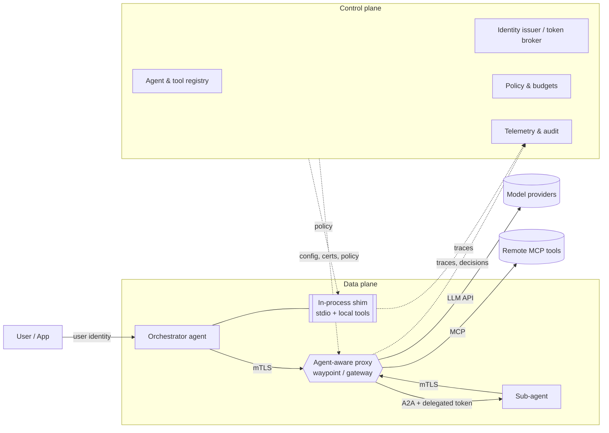
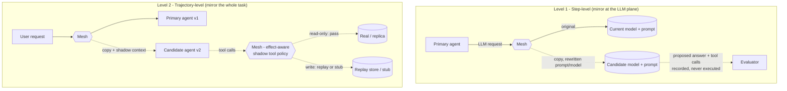
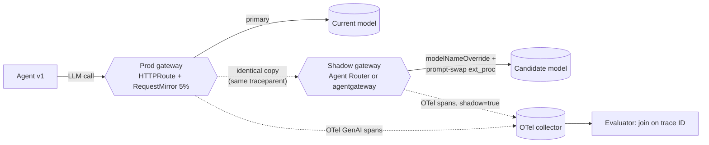

# Agent Mesh: Externalizing Cross-Cutting Concerns for AI Agents

*Concept paper. Landscape current as of 2026-11-17.*

## Abstract

A service mesh made microservices manageable by moving identity, encryption, authorization, resilience, traffic shaping and telemetry out of application code and into a shared infrastructure layer. AI agents now face the same sprawl. Every agent framework reimplements API-key handling, tool permissions, retries, rate limits and tracing, each a little differently and none of them centrally governed. An **agent mesh** applies the service-mesh pattern to agent traffic. It does so across three planes: agent → LLM, agent → tool (MCP) and agent → agent (A2A).

The thesis of this paper is that the analogy is **necessary but not sufficient**. The mesh pattern carries over cleanly for transport security, telemetry and coarse traffic management. Agents also break several assumptions a service mesh relies on:

- identity is *delegated*, not just workload-bound
- policy is *semantic*, not L4/L7
- retries are *unsafe* by default
- capacity is measured in *tokens and money*
- some traffic *never touches the network*

The interesting engineering is in those breaks. The industry has already converged on the gateway layer, so the remaining open problems sit there too.

A deep dive on **traffic mirroring** (§6) shows the pattern concretely. Shadowing a new prompt or model works well at the LLM plane, where (with provider-side tools stripped) it has no side effects. Shadowing a whole agent task requires effect-aware tool isolation, which no product surveyed here provides.

---

## 1. Background: what a service mesh externalizes, and why it won

A service mesh inserts a proxy into the path of every service-to-service call. The proxy is a sidecar or, in ambient mode, a node-level tunnel plus an optional L7 waypoint. A **control plane** configures those proxies. The result:

| Concern | What the mesh does | What the app no longer does |
|---|---|---|
| Identity & mTLS | Issues workload certificates (SPIFFE), encrypts and authenticates every hop | Manage certs and TLS config |
| Authorization | Enforces L4/L7 policy (which service may call which route) | Hand-roll ACLs |
| Reliability | Retries, timeouts, circuit breaking, outlier detection | Embed resilience libraries |
| Traffic management | Weighted routing, canaries, mirroring, rate limits | Build deploy-time routing logic |
| Observability | Uniform metrics, access logs, distributed traces | Instrument every service consistently |

It won for three reasons. **Uniformity:** one policy applies everywhere, regardless of language. **Separation of duties:** platform and security teams own policy, and developers own logic. **Zero-trust by default:** every call is authenticated.

Every one of those reasons applies to agents. Many of them apply with more force, because agents act autonomously, hold powerful credentials and are steered by untrusted text.

## 2. The agent mesh model

### 2.1 Workloads and planes

In an agent mesh the workloads are **agents**, together with the **models** and **tools** they call. Agent traffic falls into three planes:

1. **Agent → LLM.** Inference calls to model providers or self-hosted models.
2. **Agent → Tool.** Increasingly standardized on the Model Context Protocol (MCP): tool discovery (`tools/list`) and invocation (`tools/call`) over JSON-RPC.
3. **Agent → Agent.** Delegation and collaboration, increasingly standardized on the Agent2Agent protocol (A2A): Agent Cards for discovery, tasks for long-running work.

A fourth flow, **user → agent**, is the ingress. It matters mostly because it is where the *delegated* identity originates.

### 2.2 Five concerns × three planes

| Concern | Agent → LLM | Agent → Tool (MCP) | Agent → Agent (A2A) |
|---|---|---|---|
| **Identity / mTLS** | Agent authenticates to the mesh with workload identity; provider API keys live in the mesh, never in the agent | Per-agent identity (e.g. SPIFFE ID); OAuth token exchange so the tool sees *agent + user*, not a shared key | Mutual authentication plus verifiable (signed) Agent Cards; the delegation chain is carried and narrowed at every hop |
| **Security / authorization** | Prompt-injection and data-leak screening, model allowlists | Per-tool and per-*argument* policy; filtered `tools/list`; pinned tool definitions to detect tool poisoning | Who may delegate which capability to whom; scope can only shrink downstream |
| **Reliability** | Provider failover, fallback models, timeouts | Retries only for tools declared idempotent; circuit breakers; human-approval gates for high-impact tools | Task timeouts, recursion-depth and fan-out limits, dead-lettering of stuck tasks |
| **Traffic management** | Token-aware rate limits, spend budgets, model routing, semantic caching, step-level shadowing of new prompts/models (§6) | Per-tool quotas, canarying new tool versions | Capability-based routing, A/B testing agent versions, shadowing |
| **Observability** | Tokens, latency, cost per call | Every tool call with (redacted) arguments and results | One trace across the whole task tree (OpenTelemetry GenAI conventions) plus a tamper-evident audit log |

### 2.3 Control plane responsibilities

| Service mesh control plane | Agent mesh control plane |
|---|---|
| Service registry | **Agent & tool registry**: Agent Cards, MCP server catalog, versions, owners |
| Certificate authority | **Identity issuer**: workload identity plus brokering of delegated user tokens |
| Route/authz config | **Policy distribution**: tool-, argument- and delegation-level rules (CEL, Cedar, OPA) |
| Rate-limit config | **Budgets**: token and spend quotas per agent, team and user |
| Telemetry config | **Audit & evaluation pipeline**: traces, decisions, guardrail verdicts |

## 3. Where the analogy breaks

These are the places where copying the service-mesh design does not work. They are the main content of this paper.

### 3.1 Identity is delegated, not just workload-bound
mTLS answers *"which workload is calling?"* For an agent the more important question is *"on whose behalf, and with what authority?"*

A request flows user → orchestrator agent → sub-agent → tool. If the tool only sees the sub-agent's workload identity, you get the confused-deputy problem: a low-privilege user can steer a high-privilege agent into doing something the user could not do directly.

**Failure example:** an intern asks a support agent to "summarize the account". The agent holds a broad CRM service key, and a prompt injection in a ticket makes it export every customer record.

**Mesh requirement:** propagate a *chain* of identities (user, then each agent) and **attenuate scope at each hop**, using on-behalf-of token exchange and transaction-scoped tokens. Workload mTLS is the floor, not the ceiling.

### 3.2 Policy is semantic, not L4/L7
A service mesh authorizes `POST /orders` from service A. An agent mesh needs rules like *"this agent may call `send_email` only to internal domains"* or *"never call `delete_*` and `export_*` in the same session."* Those rules depend on the payload, and sometimes on combinations of calls over time.

**Mesh requirement:** parse MCP/A2A messages (JSON-RPC method, tool name, arguments) and evaluate policy over them, plus content screening of prompts and tool *responses*. Responses are an injection vector too.

### 3.3 Retries are dangerous
Service meshes retry freely because well-behaved HTTP services are idempotent (or say when they aren't). Agent tools often are not: `charge_card`, `create_ticket`, `deploy`. LLM calls are non-deterministic, so retrying one returns a *different* answer, not the same answer later.

**Failure example:** a timeout on `create_refund` triggers a mesh retry, and the customer is refunded twice.

**Mesh requirement:** tool metadata must declare idempotency or effect class. The mesh retries only safe calls, adds idempotency keys where the tool supports them, and escalates the rest to the agent or a human rather than retrying blindly.

### 3.4 The units are tokens and money, not requests per second
One request can cost a fraction of a cent or many dollars, depending on context length and model. Rate limiting on requests per second protects neither the budget nor the provider quota.

**Mesh requirement:** token-aware rate limits, cost attribution per agent, team and user, and routing that considers price and latency together.

### 3.5 Sessions are long-lived and stateful
MCP sessions over streamable HTTP/SSE, and A2A tasks, can last minutes or hours. They involve streaming and mid-task interaction such as elicitation and input requests. Request-scoped L7 assumptions (per-request timeouts, stateless load balancing, short-lived authz decisions) stop fitting.

**Mesh requirement:** session-aware routing (affinity), policy that can be re-evaluated during a session, and tracing that ties a whole task together rather than individual HTTP requests.

### 3.6 Some traffic never touches the network
A local MCP server launched over stdio, or a tool implemented as an in-process function, never passes through a proxy. A pure network mesh cannot see it. Gateways can front stdio servers that *they* launch, but nothing stops a developer's agent from spawning its own.

**Mesh requirement:** either (a) make policy require that all tools be reached through the mesh, with local stdio tools disallowed in production, or (b) ship a thin in-process SDK/shim that applies the same policy and telemetry in-process. A complete mesh probably needs both.

### 3.7 Non-determinism creates new failure modes
Agents can loop, delegate recursively, hallucinate tool names or arguments, or slowly drift off-task. Microservices fail in ways that are mostly visible from outside (errors, latency). Agents can fail *while returning 200 OK*.

**Mesh requirement:** guardrails that services never needed, such as maximum delegation depth, maximum fan-out, per-task spend ceilings and anomaly detection on tool-call patterns. Treat these as first-class circuit breakers.

## 4. Reference architecture



### 4.1 Where the data plane lives

| Placement | Pros | Cons | Best for |
|---|---|---|---|
| **Sidecar per agent** | Strong isolation, per-agent identity, sees all egress | Resource-heavy at agent scale; per-pod lifecycle | Small numbers of long-running, high-value agents |
| **Ambient + waypoint** | mTLS at the node (no sidecars); protocol-aware L7 only where needed | Kubernetes-centric; still maturing for agent protocols | Kubernetes platforms already on Istio |
| **Central gateway** | Simplest to adopt; works across clouds and runtimes; one place for policy | Choke point; misses east-west traffic unless forced through it | Getting started; SaaS-heavy tool estates |
| **In-process SDK** | Sees intent and in-process/stdio tools; no network hop | Language-bound; bypassable; upgrade burden | Filling the gaps the network layer cannot see |

The realistic answer is a **hybrid**: network enforcement (gateway or waypoint) as the trust boundary, and a thin SDK for the traffic that never touches the wire. The control plane is shared.

## 5. Landscape (as of November 2026)

The concept is not hypothetical. Several vendors use the name "agent mesh" or "agentic mesh" for it. Rows without a mark were checked against a primary vendor or project page, and those claims are still vendor-stated. Rows marked † come from search summaries and secondary sources only and were not verified against primary documentation.

| Category | Product | Planes covered | Identity / policy model | Open source | Status (vendor-stated) |
|---|---|---|---|---|---|
| Mesh-native | **agentgateway** (created by Solo.io, now Linux Foundation) | LLM, MCP, A2A | JWT, API keys, OAuth; CEL-based RBAC; OpenTelemetry | Yes (Apache-2.0) | Contributed to LF Aug 2025 |
| Mesh-native | **Istio** + agentgateway | All three (via agentgateway) | SPIFFE workload identity via ambient mesh | Yes | Agentgateway in Istio data plane: *experimental* (KubeCon EU, Mar 2026) |
| Mesh-native | **kagent** | Agent runtime on K8s; uses Istio ambient + agentgateway | Mesh mTLS; JWT to agents/MCP | Yes (CNCF Sandbox) | Sandbox |
| Mesh-native | **Solo.io Agent Mesh / agentic mesh** † | All three | Enterprise identity (OIDC/OAuth) on top of the above | Commercial | Agentic mesh docs reported as enterprise alpha |
| Hyperscaler | **Google Cloud Agent Gateway** | User→agent, agent→tool (MCP), agent→agent (A2A) | SPIFFE ID per agent; mTLS + DPoP; IAM deny-by-default; Model Armor; semantic policies | No | Available for Agent Runtime/Gemini Enterprise and GKE; Cloud Run and cross-cloud in limited preview; token budgets "coming soon" |
| Hyperscaler | **AWS Bedrock AgentCore** (Gateway, Identity, Policy) | Agent→tool (MCP) | Inbound OIDC/JWT; outbound OAuth/3LO credential brokering; Cedar policy incl. parameter-level rules; interceptors; Guardrails | No | Available |
| Hyperscaler | **Microsoft Entra Agent ID** | Identity layer (not a proxy) | Directory identities for agents; blueprints with parent-child relationships; Conditional Access; supports OAuth, MCP, A2A | No | Available to Entra customers; security features need Agent 365 licensing |
| API gateway | **Gravitee** (AI Gateway / Agent Mesh) † | All three | Gravitee's article describes the agent-gateway *category* as having agent identity, delegated user identity, method-level ACLs and per-tool quotas, and names its AI Gateway as an example. Product specifics not verified | Partly | Available |
| API gateway | **Kong AI Gateway** † | Mostly LLM; MCP plugins | Plugin-based; guardrails on enterprise tier | Partly | Available |
| LLM gateway | Envoy AI Gateway\*, Portkey\*, LiteLLM, TrueFoundry, Cloudflare AI Gateway † | Agent→LLM (some add MCP) | API keys / virtual keys; budgets; guardrails vary | Mixed | Available |
| Security | Whiteswan Agentic Gateway † | MCP, A2A | Per-session SPIFFE identities; one policy engine for MCP and A2A | No | Vendor-stated |
| Small OSS | `devdanielvaldez/agentmesh` † | MCP | Gateway/mesh for MCP: routing, circuit breakers, audit events | Yes | Early-stage |
| Small OSS | `kogunlowo123/mcp-a2a-gateway` † | MCP, A2A | Signed agent cards, pinned tool definitions, per-hop delegated authority | Yes | Early-stage |

\* Envoy AI Gateway is now **Agent Router**, an Agentic AI Foundation project. This is verified: the old docs domain redirects to theagentrouter.ai, which says it was "formerly Envoy AI Gateway", is still built on Envoy Gateway, and has the same code and maintainers. A secondary source reports that Portkey is now "Prisma AIRS AI Gateway"; that is not verified.

**Observations**

- **The gateway layer has converged.** One protocol-aware proxy that understands LLM APIs, MCP and A2A, with OAuth-based identity and a policy engine, is now table stakes. Competing there means competing with agentgateway (open source, Linux Foundation) and the hyperscalers.
- **Hyperscalers bundle the mesh into their agent platform.** Google and AWS each provide identity, gateway, policy and guardrails, but best inside their own runtime. That leaves room for something vendor-neutral.
- **Even vendors say not to merge the layers.** Gravitee's own comparison recommends running a service mesh *and* an agent gateway side by side rather than stretching either one. This supports the "analogy breaks" thesis: agent traffic needs its own layer, not just more L7 filters.

## 6. Deep dive: traffic mirroring (shadowing) for new agent versions

**Scenario.** You want to ship a new version of an agent with a changed system prompt, a different model, or both. In a service mesh you would mirror a percentage of live traffic to the new version, discard its responses, and compare. Can an agent mesh do the same?

Yes, but a naive copy of service-mesh mirroring is **unsafe and misleading** for agents. This section explains why and proposes a design.

### 6.1 Why agent mirroring is harder than service-mesh mirroring

Service-mesh mirroring (e.g. Envoy `request_mirror_policies`) is fire-and-forget: copy the request, send it to the shadow cluster, throw the response away. That works because one request is one unit of work, and the shadow backend is assumed safe to call. For agents:

| Service-mesh assumption | What happens with agents |
|---|---|
| One mirrored request = one unit of work | One mirrored task fans out into many LLM calls, tool calls and delegations. **The response is discarded, but the side effects are not**: the shadow agent can send the email or issue the refund too |
| Shadow sees the same downstream calls | The candidate makes *different* decisions, calls different tools in a different order, so there is often nothing recorded to compare against |
| Diffing responses shows regressions | Outputs are non-deterministic natural language, so a byte diff is noise. You need *evaluation*, not diffing |
| Mirroring costs one extra request | Mirroring doubles token spend, more if the candidate model is pricier or takes more steps |
| Request/response is non-interactive | Agents ask the user for input mid-task (MCP elicitation, A2A `input-required`). A shadow cannot ask the real user |
| Shadow is stateless | Agents write memory, conversation history and vector stores. Shadow writes pollute production state |
| Same data boundary | A candidate on a different model provider may be a new data processor, with data-residency and contractual implications |

### 6.2 Three levels of mirroring

The key design decision is **where in the agent loop you mirror**.



**Level 1: Step-level mirroring (LLM plane).** The mesh copies individual agent → LLM calls. Before sending the copy, it rewrites the system prompt and/or model to the candidate's. The candidate's reply, including any tool calls it *proposes*, is recorded and never executed.

- *Pros:* no side effects, *provided the mirrored copy is stripped of anything that executes inside the LLM call*: provider-hosted tools (web search, code execution, hosted connectors) and stateful API features (stored responses or conversation state). Without those, an LLM call has no side effects and nothing the candidate proposes is executed. Cheap (one extra call per step). Needs no tool isolation.
- *Gateway requirements:* request mirroring alone is not enough. The gateway must (a) rewrite the body of the *copy only* (system prompt, model, stripped server-side tools), (b) capture the mirrored response rather than discarding it, (c) handle streaming responses, and (d) tag both calls for correlation.
- *Cons:* **off-policy.** The candidate always sees the *primary's* history, so you learn "would v2 make the same next decision in v1's shoes?", not "would v2 finish the task?". Compounding errors and different multi-step strategies stay invisible.
- *Best for:* exactly the stated scenario, a **prompt tweak or model swap** where the agent's overall structure is unchanged.

**Level 2: Trajectory-level mirroring (whole task).** The mesh copies the inbound request (user → agent, or an A2A task) to the candidate agent, which runs its full loop. Every downstream call the candidate makes carries a **shadow context**, and the mesh handles each tool call according to its *effect class*:

| Tool effect class | Shadow handling |
|---|---|
| Read-only (search, lookup) | Pass through to the real backend or a read replica, under a separate rate limit |
| Idempotent / reversible write | **Replay** the primary's recorded response if the candidate's call matches (same tool + normalized arguments); otherwise **stub** with a synthetic or simulated response, or **halt** and record a divergence |
| Irreversible / external (payments, email, deploy) | Always blocked; return a stub and record the attempt |
| Delegation to another agent (A2A) | Propagate the shadow context. The sub-agent also runs in shadow mode, or its response is replayed |
| User elicitation / `input-required` | Terminate the shadow trajectory, or answer from a simulated user, and mark the result |
| Memory / state writes | Redirect to a shadow namespace that is discarded after evaluation |

- *Pros:* realistic end-to-end behavior, including multi-step strategy changes.
- *Cons:* needs reliable effect metadata, fuzzy replay matching and simulated responses. Simulated responses bias the results. Considerably more machinery.
- *Best for:* changes to agent structure, tool set or planning behavior, or high-stakes agents where Level 1 evidence is not enough.

**Level 3: Offline replay (complement, not live mirroring).** Record production traces and replay them against the candidate later in a sandbox. It is deterministic, repeatable and has zero production impact, so it is good for regression suites. But data goes stale, and replays can't capture the live tool state.

**Recommendation.** For a prompt or model change, start with **Level 1**. It is safe and cheap, and needs the least new machinery: a gateway that mirrors LLM calls with the four capabilities above. Escalate to **Level 2** only when the change affects multi-step behavior. In both cases, the shadow phase is followed by a canary.

### 6.3 Mesh mechanics

What the mesh must provide for shadowing to be safe. These are cross-cutting concerns, which is exactly why they belong in the mesh:

1. **Sampling and targeting.** A percentage, plus filters: tenant, intent or route, exclusion of sensitive cohorts. Mirroring is asynchronous, so the primary's latency is unaffected.
2. **Shadow context propagation.** A shadow marker and experiment ID travel with every hop (e.g. in W3C `baggage`), across LLM, MCP and A2A calls, so every proxy downstream applies shadow policy.
3. **Identity-based isolation.** The candidate runs under its **own workload identity** (e.g. `spiffe://…/agent/support/v2-shadow`). Policy grants that identity only read-only tools. Then even if the shadow header is dropped somewhere, the shadow *cannot* reach a side-effecting tool. Shadow egress to anything not mesh-aware fails closed.
4. **Effect classification.** A per-tool effect class from the registry. MCP tool annotations (`readOnlyHint`, `destructiveHint`, `idempotentHint`, `openWorldHint`) are a starting point. They are *hints* the MCP spec says not to trust from untrusted servers, so the registry or policy must be able to override them.
5. **Record/replay store.** The primary's tool responses are recorded, keyed by trace and normalized call, for Level 2 replay.
6. **Budget guardrails.** A token and spend cap per experiment, with automatic disable when it is hit.
7. **Correlation.** Primary and shadow spans are linked (same trace or span links) so evaluation can join them.
8. **Data governance.** The candidate's model provider must be approved for the same data classes; redaction policies apply equally.

An illustrative policy (hypothetical syntax, not an existing product):

```yaml
apiVersion: agentmesh.dev/v1alpha1
kind: AgentShadow
metadata:
  name: support-agent-v2-prompt
spec:
  target: agent/support            # primary (v1)
  candidate:
    level: step                    # step | trajectory
    model: provider-x/new-model    # model swap
    systemPromptRef: prompts/support@v2
  sampling:
    percentage: 0.05
    exclude: { dataClass: [phi, pci] }
  tools:                           # used when level: trajectory
    readOnly: passthrough
    idempotent: replay-or-halt
    irreversible: block
  budget: { maxUSD: 200, maxTokens: 50_000_000 }
  evaluation:
    judges: [pairwise-llm-judge, tool-call-agreement]
    report: dashboards/support-v2
```

### 6.4 Comparing primary and shadow

Diffing text is meaningless. Compare on these dimensions instead, aggregated statistically over the sample:

| Dimension | Metric |
|---|---|
| Decision agreement (Level 1) | Same tool chosen? Same arguments? Same "answer vs. call a tool" choice? |
| Outcome quality | Pairwise LLM-as-judge or rubric score; ground truth where it arrives later (ticket resolved, user accepted) |
| Safety | Guardrail hits; policy denials (shadow *attempted* a blocked tool); PII leakage |
| Efficiency | Tokens, cost, latency, number of steps and tool calls |
| Divergence (Level 2) | Step of first divergence from the primary; share of trajectories halted or stubbed |

### 6.5 Rollout progression

Shadowing is one stage, not the whole rollout:

1. **Shadow** (Level 1, then optionally Level 2). No user impact. Measures decision quality, safety and cost.
2. **Canary.** A small weighted percentage of *real* traffic, with real side effects and automatic rollback on metric regression.
3. **A/B.** Measures user preference and business outcomes, which shadowing **cannot** measure because users never see shadow output.
4. **Promote.** Shift weights in the registry, keeping v1 for instant rollback.

The mesh owns the mechanics of every stage: mirroring, weighted routing, metric-driven rollback, versioned registry entries. That makes it one consistent progressive-delivery workflow for prompts and models, not just for code.

### 6.6 Assessment

- **Fit with the mesh: strong.** Sampling, context propagation, identity-based isolation, budgets and trace correlation are cross-cutting. Every team would otherwise reimplement them badly.
- **What the mesh cannot do alone:** classify tool effects (needs trusted metadata), judge quality (needs evaluators) or define replay-matching semantics (domain-specific). The mesh should provide hooks for these, not the logic itself.
- **State of the market:** agentgateway documents percentage-based request mirroring at route and backend level (mirrored requests are not retried). Its examples cover MCP and generic routes. The page does not say whether mirrored responses are captured, and does not cover LLM-specific prompt or model rewriting, or A2A. This survey found no product that combines **shadow-context propagation with effect-aware tool isolation and replay**. Step-level LLM shadowing needs only modest additions to a gateway that already mirrors (§6.2). Safe trajectory-level shadowing is an open gap. Section 7 shows how far existing open standards get you.

## 7. Building shadowing on open standards (Envoy, Gateway API, Istio, Cilium)

The goal of this section is to **compose existing open standards rather than build a new mesh**. It asks: how much of §6 can be assembled from Envoy, the Kubernetes Gateway API, Istio, Cilium, agentgateway, Agent Router, SPIFFE and OpenTelemetry, and what is genuinely missing?

### 7.1 What the standards already provide (verified)

| Layer | Standard / project | Mirroring capability | Source checked |
|---|---|---|---|
| Proxy | **Envoy** `RouteAction.request_mirror_policies` | Fire-and-forget copy to a cluster, or to a cluster picked from a request header (`cluster_header`). Sampling via `runtime_fraction`. **Header mutations applied to the copy only** (`request_headers_mutations`). `host_rewrite_literal` (default: appends `-shadow` to Host). `trace_sampled` for the shadow span. Per-policy stats via `stat_prefix` are in the development docs only: Envoy v1.40.2 rejects the field, per the spike. Not supported for CONNECT/upgraded connections | Envoy API reference |
| Portable API | **Gateway API** `HTTPRoute` `RequestMirror` filter | `backendRef` plus `percent` (0–100) **or** `fraction`; 100% if neither is set. Mirror responses "MUST be ignored". Conformance features: `HTTPRouteRequestMirror`, `HTTPRouteRequestMultipleMirrors`, `HTTPRouteRequestPercentageMirror`. `percent`/`fraction` carry no experimental-channel marker in the v1 types | `apis/v1/httproute_types.go`; mirroring guide |
| Implementations | **Cilium** v1.20.0, **Envoy Gateway** v1.9.0, **Istio** 1.31 (Gateway API v1.6 reports); **agentgateway** v1.7.0 (v1.7 report) | All four list all three mirror features under `supportedFeatures` in their official conformance reports. Cilium, Envoy Gateway and Istio also report percentage mirroring among passed *provisional* tests | Gateway API conformance reports |
| Mesh API | **Istio** `VirtualService` | `mirror` + `mirrorPercentage`; fire-and-forget; `-shadow` Host suffix. Docs examples are sidecar-based; ambient/waypoint mirroring isn't documented on that page | Istio mirroring task |
| Agent gateway | **agentgateway** `requestMirror` policy | `percentage` (0.0–1.0) and `backend`, at route or backend level; mirrored requests are not retried. MCP authorization in CEL on `mcp.tool.name` / `mcp.tool.target`; denied tools are hidden from `tools/list` | agentgateway docs |
| LLM gateway | **Agent Router** (ex-Envoy AI Gateway) | `modelNameOverride` per backend (model swap via config). Native `mirrors` on `AIGatewayRoute` is an **open proposal** (issue #2137, linked PR open). The issue reports that **the mirror leg skips the gateway's ExtProc chain**, so model rewriting and body/header mutations do not run on the shadow copy, and cost metrics are double-counted | Agent Router docs; issue #2137 |
| Identity | **SPIFFE** via Istio, SPIRE, or **Cilium mutual authentication** | Distinct workload identity per deployment. Cilium's mutual auth uses SPIFFE/SPIRE but is **beta**, authenticates per identity rather than per connection, needs WireGuard/IPsec for encryption, and doesn't span Cluster Mesh | Cilium docs |
| Telemetry | **W3C Trace Context / Baggage**, **OTel GenAI conventions** | Envoy copies headers onto the mirror, so the shadow request carries the same `traceparent` and joins the primary's trace. The GenAI conventions (now in a dedicated repo) cover GenAI clients and MCP; their stability level wasn't stated on the pages checked | OTel docs; semconv-genai repo |

**Bottom line:** percentage-based mirroring is a **portable, conformance-tested standard**. One `HTTPRoute` works on Cilium, Envoy Gateway, Istio and agentgateway. You don't need to build mirroring.

### 7.2 The gap: the copy must differ from the original

Standard mirroring sends an **identical** copy. Agent shadowing (§6.2) needs a **different** copy: new system prompt, new model, provider-side tools stripped, a shadow marker.

- Raw Envoy can change *headers* on the copy only (`request_headers_mutations`). The Gateway API `RequestMirror` filter cannot.
- Nothing standard changes the *body* of the copy only. Body processing (Envoy `ext_proc`, AI-gateway request transforms) runs on the primary path. Agent Router's issue #2137 confirms it does not run on the mirror leg there.
- Sampling is **per request**. MCP sessions and A2A tasks span many requests, so a 5% per-request mirror sends the shadow fragments of sessions it has never seen.

### 7.3 Pattern A: "mirror to a shadow gateway" (step-level, for prompt/model changes)

The way around the copy-mutation gap is to mirror the *unchanged* copy to a **second gateway**, and do the rewriting on that gateway's *primary* path, where processing does run.



On the prod gateway, the configuration is a standard Gateway API route (portable across Cilium, Envoy Gateway, Istio and agentgateway):

```yaml
apiVersion: gateway.networking.k8s.io/v1
kind: HTTPRoute
metadata:
  name: llm-prod
  namespace: agents
spec:
  parentRefs:
  - name: agent-gateway
  rules:
  - matches:
    - path: { type: PathPrefix, value: /v1/chat/completions }
    filters:
    - type: RequestMirror
      requestMirror:
        backendRef: { name: shadow-llm-gateway, port: 8080 }
        percent: 5
    backendRefs:
    - name: llm-primary
      port: 8080
```

On the shadow gateway:
- **Model swap:** configuration only (e.g. Agent Router `modelNameOverride`).
- **Prompt swap and stripping provider-side tools:** a small **Envoy `ext_proc` service** that replaces the system message and removes server-executed tools. This is the only custom code on this path, and it implements an existing Envoy API.
- **Budget:** the shadow gateway's own token or rate limits cap the experiment's spend separately from production.
- **Clean metrics:** shadow traffic is the shadow gateway's *own* primary traffic, so its cost and token metrics are naturally separate. That avoids the double-counting described in #2137.
- **Correlation:** the copy keeps `traceparent`, so primary and shadow spans share a trace ID. To evaluate, you also need the primary's response content, from the prod gateway's or the agent's GenAI instrumentation with content capture enabled. Check what your gateway records before relying on this.

**Validated by a spike** ([spikes/llm-shadow](../spikes/llm-shadow/README.md)): stock Envoy v1.40.2 for both gateways, a ~130-line Go `ext_proc` prompt-swap, and mock models. Results:
- clients saw only primary responses, with unchanged latency despite a slow, flaky candidate
- model, prompt and provider-side tools were rewritten on the shadow path only
- primary and shadow joined 100% on trace ID
- the mirror percentage changed live through Envoy runtime
- the shadow failed closed when `ext_proc` was down
- the decision diff surfaced the candidate proposing a write tool (`issue_refund`) that v1 never chose

### 7.4 Pattern B: trajectory-level shadowing from standard parts

1. **Mirror at agent ingress.** A2A (JSON-RPC over HTTP) and MCP streamable HTTP are plain HTTP, so an `HTTPRoute` `RequestMirror` to a `support-agent-v2-shadow` Service works. Shadow responses are discarded.
2. **Session-sticky sampling.** Per-request percentages split sessions. Instead, decide once per session: hash the session or context ID at the edge, set a header, and mirror 100% of requests that match that header (an `HTTPRoute` header match), or use Envoy `cluster_header`. This needs a small hook; there's no standard for it.
3. **Identity isolation.** The shadow deployment gets its own ServiceAccount, and therefore its own SPIFFE ID (Istio ambient, SPIRE, or Cilium mutual auth (beta)). Use **default-deny egress** with an Istio `AuthorizationPolicy` or a `CiliumNetworkPolicy` that allows only the shadow LLM gateway and the MCP gateway. Identity is authoritative: a lost header cannot open a path to production write tools.
4. **Effect-aware tool control at the MCP gateway.** agentgateway CEL rules can restrict the shadow identity to read-only tool names. Caveats:
   - Denied tools are *hidden* from `tools/list`, so the candidate sees a different toolset than production, which biases the result.
   - Current docs say `mcpAuthorization` rules can't read tool arguments.

   A better option is to route write tools to a **stub/replay MCP server** that exposes the same tool schemas and returns recorded or synthetic results.
5. **Shadow context.** The shadow agent sets W3C Baggage (e.g. `agentmesh.shadow=exp-42`) through its OpenTelemetry SDK, so downstream spans are tagged. This is advisory; enforcement comes from identity (step 3).
6. **State isolation.** Separate memory/vector-store namespace and credentials for the shadow deployment. This is plain Kubernetes configuration.

### 7.5 Reuse, build, contribute

| Reuse as-is (open standards) | Build (thin, on standard APIs) | Contribute upstream instead of forking |
|---|---|---|
| Gateway API `RequestMirror` (percent/fraction, multiple mirrors) on Cilium, Envoy Gateway, Istio or agentgateway | **Prompt-swap `ext_proc`** (Envoy external-processing gRPC API) | Agent Router #2137: mirror-leg processing and a `shadow` metric attribute |
| Envoy `request_mirror_policies` incl. copy-only header mutations | **Stub/replay MCP server** (standard MCP server) | Gateway API: a portable way to modify headers on the mirror copy only; Envoy already has it |
| SPIFFE identities; Istio `AuthorizationPolicy` / `CiliumNetworkPolicy` for egress isolation | **Session-sticky sampling hook** (header set at the edge) | agentgateway: documented LLM-route mirroring with response capture |
| agentgateway MCP CEL authorization; Agent Router `modelNameOverride` | **Evaluator job** over OTel traces | OTel GenAI conventions: a standard attribute for shadow/experiment traffic |
| W3C Trace Context + Baggage; OTel GenAI conventions; MCP tool annotations (as hints) | | |

### 7.6 Choosing the substrate

| Option | Strengths for this use case | Limits |
|---|---|---|
| **Cilium** | Already the CNI in many clusters; Gateway API mirroring conformant (v1.20.0); identity-aware L3–L7 network policy for shadow egress isolation | Not LLM/MCP/A2A-aware; mutual auth is beta and per-identity, not per-connection. Pair it with an agent-aware gateway |
| **Istio (ambient)** | SPIFFE mTLS, `AuthorizationPolicy`, mirroring via `VirtualService` or Gateway API (1.31 conformant) | agentgateway as an Istio data-plane component is still experimental (KubeCon EU 2026 announcement) |
| **Envoy Gateway + Agent Router** | LLM-aware routing and model override on the Envoy you may already run | AI processing does not run on the mirror leg today (#2137), so use Pattern A |
| **agentgateway** | LLM-, MCP- and A2A-aware; native `requestMirror`; Gateway API mirroring conformant (v1.7.0); MCP CEL authorization | Mirroring docs show MCP and generic routes; LLM response capture and prompt rewrite need verification or an `ext_proc`-style extension |

**Recommendation:** use **Gateway API `RequestMirror`** as the portable mirroring API. Use **agentgateway or Agent Router as the shadow gateway** (Pattern A), **Cilium or Istio** for identity and default-deny egress of shadow workloads, and **OpenTelemetry** for correlation. The custom code shrinks to four thin components that sit on standard APIs:
- a prompt-swap `ext_proc`
- a stub/replay MCP server
- a sampling hook
- an evaluator

## 8. Open problems

These are the areas where current products are thinnest and where new work would matter most.

1. **End-to-end delegated identity across multi-hop A2A.** Single-hop OBO token exchange exists (AWS ↔ Entra, for example). Some projects describe per-hop delegated authority (e.g. `mcp-a2a-gateway`). This survey found no widely adopted, cross-vendor standard for a verifiable *actor chain* with scope attenuation across arbitrary agent hops.
2. **Effect-aware reliability.** None of the gateways examined here documents a model of tool side effects (idempotent / compensatable / irreversible) that drives retry or failover. MCP's tool annotations are a start, but they are untrusted hints. Without that, mesh-level retries and failover for tool calls are either disabled or unsafe.
3. **Coverage of non-network traffic.** stdio MCP servers and in-process tools sit outside every proxy. A shared policy and telemetry model that spans proxy and in-process enforcement is largely missing.
4. **Vendor-neutral policy across all three planes.** Policies are written in CEL (agentgateway), Cedar (AWS), IAM plus plain-language rules (Google) and vendor DSLs. There is no portable way to say "this agent, for this user, may do X with tool Y and delegate Z" that runs everywhere.
5. **Semantic and behavioral circuit breakers.** Loop, runaway-delegation and spend anomalies are handled ad hoc. They deserve the same first-class treatment that outlier detection gets in a service mesh.
6. **Safe trajectory-level shadowing.** Mirroring whole agent tasks needs shadow-context propagation, effect-aware tool isolation and record/replay (§6). Open standards cover request-level mirroring (Gateway API, Envoy, Istio, Cilium, agentgateway) and identity isolation (§7). Missing pieces: mutating the copy only, session-sticky sampling and replay of side-effecting tools.
7. **Evaluation as observability.** Traces show *what* happened. Agent operators also need *whether it was right*, so guardrail verdicts and evaluation scores belong in the same telemetry pipeline.

## 9. Conclusion

Applying the service-mesh pattern to agents is sound, and the market has validated it: the protocol-aware gateway for LLM, MCP and A2A traffic is quickly becoming standard infrastructure. A literal port of the service mesh is not enough, though. The agent mesh has to carry *who the agent is acting for*, reason about *what a call does* rather than where it goes, treat *side effects and spend* as first-class, and reach traffic that *never touches the network*. Traffic mirroring shows all of this in one feature: trivial for microservices, safe for agents only at the LLM plane, and an open problem for whole tasks. Those differences, rather than the shared mTLS-and-tracing foundation, are where the next generation of this layer will be decided.

---

## References

### Primary sources fetched for this paper

- agentgateway: <https://github.com/agentgateway/agentgateway>; LF contribution: <https://agentgateway.dev/blog/2025-08-25-solo-contributes-agentgateway-to-lf>
- CNCF: Istio brings future-ready service mesh to the AI era (Mar 2026): <https://www.cncf.io/announcements/2026/03/25/istio-brings-future-ready-service-mesh-to-the-ai-era-with-new-ambient-multicluster-gateway-api-inference-extension-and-more/>
- kagent: Inside Kagent: <https://kagent.dev/blog/inside-kagent-oss-ent-ai-meshes>
- Google Cloud: Agent Gateway overview: <https://docs.cloud.google.com/gemini-enterprise-agent-platform/govern/gateways/agent-gateway-overview>
- AWS: Govern AI agent tool access with AgentCore Gateway: <https://aws.amazon.com/blogs/machine-learning/govern-ai-agent-tool-access-with-amazon-bedrock-agentcore-gateway/>; OBO token exchange with Entra: <https://aws.amazon.com/blogs/machine-learning/servicenow-on-behalf-of-token-exchange-with-bedrock-agentcore-gateway/>
- Microsoft: What is Microsoft Entra Agent ID: <https://learn.microsoft.com/en-us/entra/agent-id/what-is-microsoft-entra-agent-id>
- Gravitee: Agent Mesh vs Service Mesh: <https://www.gravitee.io/blog/agent-mesh-vs-service-mesh>
- agentgateway request mirroring: <https://agentgateway.dev/docs/standalone/latest/configuration/resiliency/mirroring/>
- MCP spec (2025-06-18), Tools ("clients MUST consider tool annotations to be untrusted unless they come from trusted servers"): <https://modelcontextprotocol.io/specification/2025-06-18/server/tools>. The annotation hint names (`readOnlyHint`, `destructiveHint`, `idempotentHint`, `openWorldHint`) are defined in the spec schema: <https://modelcontextprotocol.io/specification/2025-06-18/schema>

- Envoy `RequestMirrorPolicy`: <https://www.envoyproxy.io/docs/envoy/latest/api-v3/config/route/v3/route_components.proto#config-route-v3-routeaction-requestmirrorpolicy>
- Gateway API HTTP request mirroring guide: <https://gateway-api.sigs.k8s.io/guides/http-request-mirroring/>; `HTTPRequestMirrorFilter` type: <https://github.com/kubernetes-sigs/gateway-api/blob/main/apis/v1/httproute_types.go>
- Gateway API conformance reports (Cilium v1.20.0, Envoy Gateway v1.9.0, Istio 1.31 under v1.6; agentgateway v1.7.0 under v1.7): <https://github.com/kubernetes-sigs/gateway-api/tree/main/conformance/reports>
- Istio traffic mirroring: <https://istio.io/latest/docs/tasks/traffic-management/mirroring/>
- Cilium Gateway API support: <https://docs.cilium.io/en/stable/network/servicemesh/gateway-api/gateway-api/>; mutual authentication (beta): <https://docs.cilium.io/en/stable/network/servicemesh/mutual-authentication/mutual-authentication/>
- Agent Router (formerly Envoy AI Gateway), model name virtualization: <https://theagentrouter.ai/docs/capabilities/traffic/model-name-virtualization>; mirroring proposal: <https://github.com/envoyproxy/ai-gateway/issues/2137>
- OpenTelemetry GenAI semantic conventions: <https://github.com/open-telemetry/semantic-conventions-genai>

### Search-only / secondary sources (not independently verified)

- agentgateway MCP authorization (CEL): <https://agentgateway.dev/docs/standalone/latest/configuration/security/mcp-authz/>

- Solo.io: Agent Mesh for Enterprise Agents: <https://www.solo.io/blog/agent-mesh-for-enterprise-agents>; agentic mesh docs: <https://docs.solo.io/istio/1.31.x/agentic-mesh/about/>
- Whiteswan Agentic Gateway: <https://whiteswansecurity.com/platform-agentic-gateway>
- Open-source examples: <https://github.com/devdanielvaldez/agentmesh>, <https://github.com/kogunlowo123/mcp-a2a-gateway>
- Envoy AI Gateway rename / LiteLLM migration (Tetrate): <https://tetrate.io/learn/ai/litellm-migration-guide>
- Arize: shadow testing for LLMs/agents: <https://arize.com/glossary/shadow-testing-llms-agents/>
- Shadow mode for agentic AI (side effects of shadowed tool calls): <https://urandom.io/blog/2026-03-02-shadow-mode-for-agentic-ai>
- LLM gateway comparison (Arize): <https://arize.com/resources/best-llm-gateways-comparison/>
